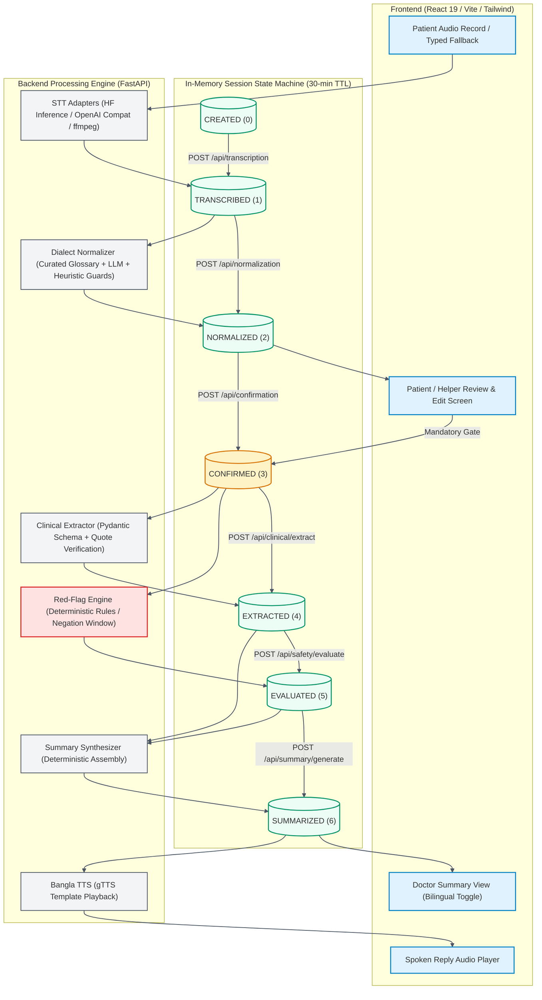

# Kotha (কথা) — Dialect-to-Clinical-Note Voice Assistant

> **CoU AI Hackathon 2026 Prototype**  
> **Domain:** Healthcare Accessibility & Clinical Intake  
> **Core Mandate:** Enabling rural Bangladeshi patients speaking regional dialects to be accurately heard and structured for clinical review.  
> 
> ⚠️ **CLINICAL SAFETY DISCLAIMER**  
> **Kotha is NOT a diagnostic tool.** It does not provide diagnoses, prescribe treatments, or suggest medications. All medical judgments, diagnoses, and triage decisions must be performed by a qualified human healthcare professional. This is an experimental hackathon prototype with **zero clinical validation**. Red-flag rules are draft heuristics marked `pending_clinical_review`.

---

## 1. Overview & Problem

In Bangladesh, more than 170 million people speak Bengali, yet healthcare delivery in rural upazilas and community clinics faces a severe linguistic bottleneck:

1. **Dialectal Diversity**: Patients communicate in rich regional dialects (Sylheti, Chittagonian, Noakhali, Barisali, etc.) featuring distinct lexical terms for pain, anatomical locations, and duration (e.g., Chittagonian *"হিনাত বিষ"* or Sylheti *"ছাতিত ব্যতা"* for chest pain; *"ফেডে বিষ"* for abdominal pain).
2. **Clinical Communication Gap**: Attending physicians and community health workers (CHWs) are trained in standard Bangla and English medical nomenclature. Misinterpreting colloquial or dialectal symptom descriptions can lead to misdiagnosed severity, overlooked emergencies, or delayed care.
3. **Speech Recognition Fragility**: Commercial and foundation Automatic Speech Recognition (ASR) models are primarily trained on standard literary Bangla (Sadhu/Cholit bhasha) or English. When presented with regional phonology and dialect vocabularies, Word Error Rates (WER) surge significantly, frequently dropping critical negation markers (e.g., *"নাই"* / *"না"* / *"নো"*).
4. **Diagnostic Creep & LLM Hallucination Risk**: Unconstrained generative AI systems in healthcare frequently hallucinate plausible-sounding diagnoses, assume absent symptoms are negative findings, or offer unsolicited clinical advice.

---

## 2. Solution: Guarded 8-Step Pipeline

Kotha addresses these challenges by combining **regional speech-to-text**, **dialect normalization**, a **mandatory patient confirmation gate**, **schema-constrained clinical extraction**, and a **deterministic (non-LLM) red-flag engine**.

The system is deliberately designed so that:
- The patient/helper always inspects and confirms the normalized text before any clinical extraction occurs.
- Red-flag alerts are evaluated strictly by deterministic keyword and negation rules—the LLM has zero authority to suppress or trigger emergency warnings.
- The physician receives a high-density bilingual (Bangla/English) summary card clearly separating patient statements from extracted data.
- The patient receives a reassuring spoken audio message synthesized from a static template that never leaks clinical data to cloud TTS.

---

## 3. Architecture & Data Flow



### The 8 Pipeline Stages
1. **Intake & Audio Capture (`Stage.CREATED`)**: Web Audio API captures up to 90 seconds of audio (16 kHz mono WAV transcode via ffmpeg) or accepts typed input.
2. **Transcription (`Stage.TRANSCRIBED`)**: Provider-independent STT adapter converts speech to regional transcript.
3. **Dialect Normalization (`Stage.NORMALIZED`)**: Longest-match dialect glossary scans terms (Sylheti, Chittagonian, Noakhali), then LLM suggests a standard Bangla rewrite guarded by negation count and numeral preservation checks.
4. **Patient Confirmation Gate (`Stage.CONFIRMED`)**: **The core safety boundary.** The patient or community health worker reviews side-by-side transcripts and can edit the text. Downstream endpoints reject unconfirmed sessions with `409 Conflict`.
5. **Structured Clinical Extraction (`Stage.EXTRACTED`)**: LLM populates a strict Pydantic clinical schema (`reported`, `uncertain`, `not_reported`) requiring verbatim quotation evidence. Diagnoses and prescriptions are strictly banned.
6. **Deterministic Safety Evaluation (`Stage.EVALUATED`)**: Rule-based keyword matching with clause-bounded negation detection scans confirmed text. Zero LLM involvement.
7. **Bilingual Summary Generation (`Stage.SUMMARIZED`)**: Deterministic assembly of the physician's intake card in Bangla and English.
8. **Spoken Patient Reply**: Non-clinical template audio synthesized via `gTTS` confirming intake receipt and advising the patient to wait for the clinician.

---

## 4. Key Features

- **Mandatory Confirmation Gate**: Direct API calls attempting extraction prior to confirmation receive an immediate `409 Conflict (WORKFLOW_ORDER_VIOLATION)`.
- **Zero-Storage Privacy Design**: No database (no SQLite, Postgres, or Redis). In-memory session store expires after 30 minutes. All ffmpeg audio temp files are unlinked in `finally` blocks.
- **Log Redaction**: Patient transcripts, audio bytes, and credentials are strictly excluded from logging. Only session IDs, stage transitions, and sanitized error types are logged.
- **Meaning Preservation Guards**: Rejects LLM normalizations that alter negation polarity (e.g. *"নাই"* vs *"আছে"*), drop numbers, or tamper with duration units.
- **Explicit Uncertainty Handling**: Missing symptoms remain `not_reported`. Hedged or vague statements remain `uncertain`. Never inferred as negative findings.
- **Honest Demo Mode**: Three fictional scenarios (`A_ordinary`, `B_red_flag`, `C_uncertain`) clearly tagged with `"mode": "demo"` across the UI and API payloads.
- **Bilingual Clinician Dashboard**: Instant toggle between standard Bangla and English with color-coded red-flag alert banners and print-to-PDF support.

---

## 5. Technology Stack

### Backend
- **Framework**: FastAPI `0.115.x`, Uvicorn `0.30.x`, Python 3.11+
- **Validation**: Pydantic `2.9.x`, Pydantic-Settings `2.5.x`
- **HTTP & Concurrency**: HTTPX `0.27.x`, asyncio
- **Audio Processing**: ffmpeg subprocess transcoding, Python standard library `wave`
- **Speech Synthesis**: gTTS `2.5.x` (Google Translate TTS web API)
- **Testing**: pytest `8.x`, pytest-asyncio `0.24.x`

### Frontend
- **Framework**: React `19.3.x`, TypeScript `5.x`, Vite `8.3.x`
- **Routing**: React Router DOM `7.18.x`
- **Styling**: Tailwind CSS `v4.3.x`, `@tailwindcss/vite`
- **Icons**: Lucide React `1.77.x`
- **Typography**: Google Fonts (*Hind Siliguri* for Bengali, *Inter* for English)
- **Testing**: Vitest `5.1.x`, `@testing-library/react` `16.3.x`, Playwright `1.65.x`

---

## 6. Repository Structure

```
├── backend/
│   ├── app/
│   │   ├── main.py                  # FastAPI application entrypoint & lifecycle
│   │   ├── config.py                # Pydantic Settings & environment validation
│   │   ├── api/
│   │   │   ├── deps.py              # Dependency injection for SessionManager & Settings
│   │   │   └── routes/              # Modular API endpoints
│   │   │       ├── health.py        # System health & provider readiness
│   │   │       ├── session.py       # Session initialization and TTL lifecycle
│   │   │       ├── transcription.py # Audio upload & typed transcript intake
│   │   │       ├── normalization.py # Glossary matching & LLM rewrite
│   │   │       ├── confirmation.py  # Mandatory patient review gate
│   │   │       ├── extraction.py    # Structured clinical schema extraction
│   │   │       ├── safety.py        # Deterministic red-flag evaluation
│   │   │       ├── summary.py       # Deterministic bilingual note assembly
│   │   │       ├── speech.py        # Bangla TTS audio generation
│   │   │       └── demo.py          # Prepared demo scenarios and audio streaming
│   │   ├── core/
│   │   │   ├── session_manager.py   # In-memory TTL state machine with Stage gates
│   │   │   ├── logging.py           # Redacting logger (no transcripts or audio)
│   │   │   ├── security.py          # Magic byte validation & audio container check
│   │   │   └── exceptions.py        # Custom KothaError & status code mappers
│   │   ├── schemas/                 # Pydantic models for all request/response schemas
│   │   ├── services/                # Business logic & external adapters
│   │   │   ├── speech_to_text.py    # LocalTransformersSTT, HFInferenceSTT, OpenAICompatSTT
│   │   │   ├── llm_provider.py      # AnthropicProvider, OpenAICompatProvider
│   │   │   ├── glossary_service.py  # Longest-match Trie/regex dialect term matcher
│   │   │   ├── dialect_normalizer.py# Guarded normalization with fallback
│   │   │   ├── clinical_extractor.py# LLM extractor with quote validation
│   │   │   ├── red_flag_engine.py   # Deterministic rules + clause-bounded negation
│   │   │   ├── summary_generator.py # Bilingual note generator
│   │   │   └── text_to_speech.py    # Template-based gTTS synthesizer
│   │   └── data/
│   │       ├── dialects/            # Sylheti, Chittagonian, Noakhali, Standard glossaries
│   │       └── safety_rules/        # red_flags.json (10 emergency/urgent rules)
│   └── tests/                       # 11 test modules (131 unit/integration tests)
├── frontend/
│   ├── src/
│   │   ├── pages/                   # Landing, Intake, Confirm, Summary, About
│   │   ├── components/              # UI primitives, Audio recorder, Spoken reply
│   │   ├── hooks/                   # useRecorder (MediaRecorder + Web Audio VU meter)
│   │   ├── state/                   # FlowContext (in-memory React session state)
│   │   ├── services/                # Typed fetch API client
│   │   └── test/                    # Vitest unit and component tests (33 tests)
│   └── e2e/                         # Playwright E2E workflows (desktop & mobile)
├── demo_assets/                     # Fictional scenario audio clips & transcripts
├── docs/                            # ARCHITECTURE.md, Kotha.pdf
└── CLAUDE.md                        # Development guide and engineering invariants
```

---

## 7. Setup & Installation

### Prerequisites
- **Python**: 3.11+ (tested on Python 3.11 & 3.14)
- **Node.js**: 20+ (tested on Node 22+)
- **ffmpeg**: Installed and available in system `PATH` (for audio transcoding)
  - Windows: `winget install Gyan.FFmpeg`
  - macOS: `brew install ffmpeg`
  - Ubuntu: `sudo apt install ffmpeg`

### 7.1 Backend Setup
```powershell
# 1. Navigate to backend directory
cd backend

# 2. Create and activate virtual environment
python -m venv .venv
.venv\Scripts\Activate.ps1    # On Linux/macOS: source .venv/bin/activate

# 3. Install dependencies
pip install -r requirements.txt

# 4. Create environment configuration
copy .env.example .env        # On Linux/macOS: cp .env.example .env

# 5. Start development server
uvicorn app.main:app --reload --port 8000
```
- Interactive Swagger API docs: [http://localhost:8000/docs](http://localhost:8000/docs)
- Health check: [http://localhost:8000/api/health](http://localhost:8000/api/health)

### 7.2 Frontend Setup
```powershell
# 1. Open a new terminal and navigate to frontend directory
cd frontend

# 2. Install dependencies
npm install

# 3. Start Vite development server
npm run dev
```
- Web Application: [http://localhost:5173](http://localhost:5173)

### 7.3 Verify live providers before the demo

Before running live mode demonstrations or evaluation sessions, run the automated provider checker script from the backend directory:

```powershell
cd backend
.venv\Scripts\python scripts/check_providers.py
# On Linux/macOS: python scripts/check_providers.py
```

This sequentially verifies:
1. `ffmpeg` binary availability in system `PATH`.
2. Speech-to-Text (STT) transcription on sample audio.
3. LLM dialect normalization on sample text.
4. LLM structured clinical extraction.
5. Text-to-Speech (TTS) synthesis of the patient reply template.

It outputs sanitized execution times and errors (never printing transcripts, model responses, or secret keys) and exits with code `0` only when all checks pass.

---

## 8. Environment Variables Reference

All backend configurations are managed via `backend/.env` (read by `app/config.py`). Keys stay on the backend and are never sent to the browser:

| Variable | Type | Default | Description |
|---|---|---|---|
| `APP_MODE` | `string` | `demo` | Application mode: `demo` (prepared scenarios) or `live` (calls real APIs). |
| `SESSION_TTL_MINUTES` | `int` | `30` | In-memory session time-to-live before automatic garbage collection. |
| `SESSION_TTL_SECONDS` | `int` | `1800` | In-memory session TTL in seconds. |
| `SPEECH_PROVIDER` | `string` | `none` | Speech-to-text adapter: `none`, `local_transformers`, `hf_inference`, or `openai_compatible`. |
| `SPEECH_MODEL` | `string` | `bangla-speech-processing/BanglaASR` | Model identifier (HF repo or OpenAI model name e.g. `whisper-1`). |
| `SPEECH_API_KEY` | `string` | `""` | API key for cloud STT endpoints (HF Inference or OpenAI-compatible). **Not required** for local Hugging Face model (`local_transformers`), which needs only a model download. |
| `SPEECH_BASE_URL` | `string` | `""` | Optional endpoint override (e.g. custom Groq/vLLM URL). |
| `LLM_PROVIDER` | `string` | `none` | Configurable LLM adapter: `none`, `anthropic`, or `openai_compatible` (e.g. OpenAI, Groq, Ollama, vLLM). |
| `LLM_MODEL` | `string` | `""` | Model identifier configurable via environment (e.g. any Claude, GPT, or Llama model). |
| `LLM_API_KEY` | `string` | `""` | API key for configured LLM provider. |
| `LLM_BASE_URL` | `string` | `""` | Optional base URL override (for Groq, Ollama, vLLM, or custom proxies). |
| `TTS_PROVIDER` | `string` | `gtts` | Bangla speech synthesis adapter: `gtts` (in-memory, no API key required) or `none`. |
| `MAX_AUDIO_SECONDS` | `int` | `90` | Hard cap on audio recording duration. |
| `MAX_UPLOAD_MB` | `int` | `10` | Maximum uploaded audio payload size in megabytes. |
| `MAX_AUDIO_BYTES` | `int` | `10485760` | Maximum raw audio payload in bytes (10 MB). |
| `PROVIDER_TIMEOUT_SECONDS` | `int` | `60` | Timeout for third-party HTTP API calls. |
| `CORS_ORIGINS` | `string` | `http://localhost:5173,...` | Comma-separated list of allowed frontend origins. |

---

## 9. API Reference

All requests and responses use JSON (except multipart audio uploads and audio byte streams).

| Endpoint | Method | Required State | Description |
|---|---|---|---|
| `/api/health` | `GET` | *Any* | System status, mode, and provider readiness. |
| `/api/session` | `POST` | *Any* | Initializes a fresh session with demographic context. |
| `/api/session/{id}` | `GET` | *Any* | Fetches session metadata and current stage. |
| `/api/session/{id}` | `DELETE` | *Any* | Immediately purges the session from memory. |
| `/api/glossary/stats` | `GET` | *Any* | Returns verified and unverified term counts per dialect. |
| `/api/demo/samples` | `GET` | *Any* | Lists prepared demo scenarios (A, B, C). |
| `/api/demo/audio/{scenario_id}` | `GET` | *Any* | Streams WAV audio for a prepared demo scenario. |
| `/api/demo/live-asr` | `POST` | *Any* | Runs real ASR on a demo sample for judge evaluation. |
| `/api/transcription` | `POST` | `CREATED` | Transcribes multipart audio; advances to `TRANSCRIBED`. |
| `/api/transcription/typed` | `POST` | `CREATED` | Accepts manually typed text; advances to `TRANSCRIBED`. |
| `/api/normalization` | `POST` | `TRANSCRIBED` | Normalizes dialect text; advances to `NORMALIZED`. |
| `/api/confirmation` | `POST` | `NORMALIZED` | **Gate:** Confirms patient text; advances to `CONFIRMED`. |
| `/api/clinical/extract` | `POST` | `CONFIRMED` | Structured symptom extraction; advances to `EXTRACTED`. |
| `/api/safety/evaluate` | `POST` | `CONFIRMED` | Evaluates deterministic red flags; advances to `EVALUATED`. |
| `/api/summary/generate` | `POST` | `EVALUATED` | Generates bilingual summary card; advances to `SUMMARIZED`. |
| `/api/speech/generate` | `POST` | `SUMMARIZED` | Synthesizes spoken Bangla reassurance template. |

### Sample Payloads

#### 1. Confirm Patient Text (`POST /api/confirmation`)
**Request**:
```json
{
  "session_id": "9b1deb4d-3b7d-4bad-9bdd-2b0d7b3dcb6d",
  "confirmed_text": "আজ তিন দিন ধরে আমার মাথায় ব্যথা, অল্প জ্বর আছে। সারাদিন ভালো লাগছে না।",
  "edited": true,
  "confirmed_by": "patient"
}
```
**Response** (`200 OK`):
```json
{
  "session_id": "9b1deb4d-3b7d-4bad-9bdd-2b0d7b3dcb6d",
  "confirmed_text": "আজ তিন দিন ধরে আমার মাথায় ব্যথা, অল্প জ্বর আছে। সারাদিন ভালো লাগছে না।",
  "edited": true,
  "confirmed_by": "patient",
  "confirmed_at": "2026-11-22T23:55:00Z",
  "mode": "live"
}
```

#### 2. Red-Flag Safety Evaluation (`POST /api/safety/evaluate`)
**Response** (`200 OK`):
```json
{
  "session_id": "9b1deb4d-3b7d-4bad-9bdd-2b0d7b3dcb6d",
  "highest_alert_level": "emergency",
  "triggered_rules": [
    {
      "rule_id": "CHEST_PAIN",
      "name_en": "Chest pain",
      "name_bn": "বুকে ব্যথা",
      "alert_level": "emergency",
      "matched_term": "বুকে ব্যথা",
      "matched_clause": "দুই ঘণ্টা ধরে বুকে খুব ব্যথা",
      "review_status": "pending_clinical_review",
      "explanation_bn": "বুকে ব্যথা বা অস্বস্তির কথা বলা হয়েছে। এটি হার্টের সমস্যা বা গুরুতর অসুস্থতার লক্ষণ হতে পারে।",
      "recommended_action_bn": "অবিলম্বে নিকটস্থ জরুরি চিকিৎসা কেন্দ্রে বা হাসপাতালে যান।",
      "recommended_action_en": "Seek emergency medical care immediately at the nearest healthcare facility."
    }
  ],
  "disclaimer_bn": "কোনো সতর্কতা না থাকার অর্থ এই নয় যে রোগী নিরাপদ। এটি রোগীর কথার ওপর নির্ধারিত নিয়মভিত্তিক পরীক্ষা, চিকিৎসা মূল্যায়ন নয়।",
  "disclaimer_en": "No alert does NOT mean the patient is safe. Alerts are keyword rules over what the patient said, not a clinical assessment. Kotha is not a diagnostic tool."
}
```

---

## 10. AI Models, Providers & Honest Limitations

### Models Actually Integrated in Code
1. **Speech-to-Text (STT)**:
   - `bangla-speech-processing/BanglaASR` (Whisper fine-tune via Hugging Face Inference or local `transformers` pipeline; local pipeline requires only downloading model weights, no API key).
   - `whisper-1` (or equivalent) via any OpenAI-compatible `/audio/transcriptions` endpoint.
   - *Manual Fallback*: `POST /api/transcription/typed` (tagged `source: "typed_by_helper"`).
2. **Configurable Large Language Models (LLM)**:
   - Configurable via `LLM_PROVIDER`, `LLM_MODEL`, and `LLM_BASE_URL`.
   - Supports Anthropic Messages API (e.g. `claude-3-5-sonnet-20241022` / `claude-3-7-sonnet-20250219`).
   - Supports any OpenAI-compatible Chat API (e.g. `gpt-4o-mini`, `llama-3.3-70b-versatile` via Groq, vLLM, or local Ollama).
   - *Deterministic Fallback*: Glossary-only longest-match term replacement when LLM is unconfigured or unreachable.
3. **Speech Synthesis (TTS)**:
   - `gTTS` (Google Translate TTS web API, language `bn`). Synthesizes static reassurance templates without transmitting patient health data.

### Known Limitations
- **Dialect ASR Accuracy**: Zero-shot standard Bangla Whisper models exhibit high Word Error Rates (WER) on regional phonetics (e.g., Sylheti tonal shifts, Chittagonian spirantization). The system mitigates this via the mandatory confirmation gate and typed fallback.
- **Negation Heuristics**: Clause-bounded negation detection uses token distance windows (3 tokens) and punctuation clause splitting. Complex multi-clause or idiomatic double-negations in dialectal speech may over-alert (by design, prioritizing sensitivity over specificity).
- **Rule Clinical Status**: All 10 red-flag rules are currently marked `pending_clinical_review`. They are engineering heuristics, not validated triage algorithms.
- **In-Memory Volatility**: Single-server process memory. Server restart clears active sessions.

---

## 11. Datasets & Licences

### Actually Used in Codebase
- **Curated Starter Dialect Glossaries** (`backend/app/data/dialects/*.json`): 43 total starter entries across Sylheti, Chittagonian, Noakhali, and Standard Bangla. All marked `verification_status: "unverified"`. Licence: TO BE DECIDED by the team.
- **Synthetic Demo Scenarios** (`demo_assets/`): 3 fictional patient profiles with synthetic standard-Bangla audio recordings (gTTS reading dialect text, not native speakers) and transcript pairs. Licence: TO BE DECIDED by the team.

### Unused Raw Datasets in Repository (Unconfirmed Licences)
The following CSV files committed in `demo_assets/raw_datasets/` are **not used** in any runtime, test, or build code path. Their origin and licence are unconfirmed (`UNKNOWN - team must fill in`, documented in `demo_assets/raw_datasets/SOURCE.md`):
- `demo_assets/raw_datasets/Barishal_NER.csv` (Licence: UNKNOWN)
- `demo_assets/raw_datasets/Chittagong_NER.csv` (Licence: UNKNOWN)
- `demo_assets/raw_datasets/Mymensingh_NER.csv` (Licence: UNKNOWN)
- `demo_assets/raw_datasets/Noakhali_NER.csv` (Licence: UNKNOWN)
- `demo_assets/raw_datasets/Regional_NER (Raw Sentences).csv` (Licence: UNKNOWN)
- `demo_assets/raw_datasets/Sylhet_NER.csv` (Licence: UNKNOWN)

### Planned / Reviewed, Not Integrated
- **Mozilla Common Voice Bangla 17.0** (CC-0): Reviewed as candidate for acoustic fine-tuning; not bundled in prototype.
- **SHRUTI Speech Corpus** (Academic Non-Commercial): Reviewed for regional acoustic benchmarks; not bundled.
- **Bengali.AI Speech & Dialect Dataset** (CC-BY-NC-SA 4.0): Reviewed for regional pronunciation variants; not bundled.
- **RegSpeech12 / Ben-10**: Named in initial hackathon concept paper; licences unverified, not used.

---

## 12. Demo Walkthrough: 3 Scenarios

To demonstrate Kotha during evaluation, toggle to **Demo mode** in the top navigation bar or intake screen:

| Scenario | Title | Description | Expected Pipeline Outcome |
|---|---|---|---|
| **Scenario A** | *Ordinary Symptoms* (`A_ordinary`) | Sylheti dialect: Headache and mild fever for 3 days; took 1 paracetamol. | Normalizes cleanly; 0 red flags triggered; summary highlights mild symptoms and lists unstated items under *"Ask about..."*. |
| **Scenario B** | *Red-Flag Emergency* (`B_red_flag`) | Chittagonian dialect: Severe chest pain and breathing difficulty for 2 hours. | Deterministic red-flag engine fires `CHEST_PAIN` and `BREATHING_DIFFICULTY`; emergency red alert banner `#C62828` appears with immediate referral advice. |
| **Scenario C** | *Uncertain / Incomplete* (`C_uncertain`) | Noakhali dialect: Intermittent abdominal pain; duration forgotten; fever unknown. | Schema strictly preserves `uncertain` for duration and fever; never flags symptoms as negative; alerts clinician to clarify. |

*Note on Demo Audio: Audio clips are synthetic standard-Bangla voice (gTTS) reading dialect text, not native dialect speakers. Running live ASR on these clips demonstrates speech-to-text pipeline execution, but does NOT indicate dialect recognition accuracy on authentic regional speech.*

### Adding Real Consented Recordings

To replace or extend synthetic demo audio with authentic regional dialect recordings:

1. **Obtain Explicit Informed Consent (Mandatory)**:
   - Explicit speaker consent is strictly required before recording or committing any human voice data.
   - Speakers must be informed of how the audio will be used (open-source evaluation of dialect clinical triage) and explicitly agree to repository inclusion. Never record or commit voice data without documented speaker consent.

2. **Audio File Placement and Formatting**:
   - Save the recording in `demo_assets/audio/` using the scenario naming convention (e.g. `sample_A.wav` for Scenario A, `sample_B.wav` for Scenario B, `sample_C.wav` for Scenario C, or `sample_D.wav` for new scenarios).
   - Format: 16 kHz mono 16-bit PCM WAV (`.wav`).

3. **Register Metadata in `demo_assets/transcripts.json`**:
   Add or update the scenario entry with the following fields:
   - `id`: Scenario ID (e.g. `"A_ordinary"`).
   - `scenario`: Scenario ID.
   - `audio_file`: Audio file name (e.g. `"sample_A.wav"`).
   - `title`: Descriptive clinical title.
   - `purpose`: Clinical scenario context and symptoms.
   - `dialect`: Authentic regional dialect (e.g. `"sylheti"`).
   - `speaker`: Verified speaker profile (e.g. `"Consented native Sylheti speaker (Habiganj, age 42)"`).
   - `original_transcript`: Exact verbatim transcription of spoken dialect.
   - `standard_bangla`: Clinically accurate standard Bangla translation.
   - `verified_by`: Name or identifier of the native speaker / clinician who verified the transcript (replaces `"sample / unverified"`).

---

## 13. Test Results & Verification (Step 14)

All tests execute against strict regression suites without network dependencies:

```powershell
# Backend Test Suite (131 tests)
backend\.venv\Scripts\python -m pytest -q --basetemp=backend/.pytest_tmp
# Result: 131 passed in 18.95s

# Frontend Unit & Component Tests (33 tests)
cd frontend; npm test
# Result: 33 passed in 3.94s

# Frontend Production Build
cd frontend; npm run build
# Result: Built cleanly in 923ms (0 TypeScript errors)

# Playwright End-to-End Suite
cd frontend; npx playwright test
# Result: 4 passed, 2 skipped (@live requiring external keys), 0 failed in 19.7s
# Checked on Desktop Chrome (1280x720) and Mobile Chrome (360x740)
```

### Verified Test Properties
- **No-Storage Guarantee**: Verified by `test_no_persistent_data.py`. Confirmed zero files created on disk during full workflow, and verified zero transcript or audio text in `DEBUG` logs.
- **Confirmation Boundary**: Verified by `test_confirmation_gate.py`. Direct extraction or summary calls prior to confirmation raise `409 Conflict`.
- **Negation & Quantity Preservation**: Verified by `test_normalization.py`. Rewrites altering negative polarity or numbers are rejected.

### What was and was not verified (as of 2026-11-24)

Automated live provider check (`backend/scripts/check_providers.py`) executed on 2026-11-24:
- **Verified (PASS)**:
  - `ffmpeg present`: System `PATH` includes valid `ffmpeg` binary (0.004s).
  - `TTS: synthesize template reply`: Bangla speech synthesis via `gTTS` in-memory stream generation (4.752s).
- **Not Verified (FAIL / Not Configured)**:
  - `STT: transcribe sample_A.wav`: Not verified (`speech_provider` is set to `none`; `PROVIDER_NOT_CONFIGURED`). Live ASR requires configuring `SPEECH_PROVIDER` and corresponding credentials or local model download.
  - `LLM: normalize text`: Not verified (`llm_provider` is set to `none`; `PROVIDER_NOT_CONFIGURED`). Live normalization requires configuring `LLM_PROVIDER` and `LLM_API_KEY`.
  - `LLM: extract clinical info`: Not verified (`llm_provider` is set to `none`; `PROVIDER_NOT_CONFIGURED`). Live clinical extraction requires configuring `LLM_PROVIDER` and `LLM_API_KEY`.

---

## 14. Privacy, Security & Ethics

1. **Zero Patient Record Retention**: In-memory storage only. No database, no tracking cookies, no localStorage. Sessions automatically expire after 30 minutes.
2. **Log Redaction**: Structured logging (`app/core/logging.py`) sanitizes output to exclude transcripts, audio payloads, and authorization headers.
3. **No Clinical Decisions by LLM**: The LLM's role is strictly confined to dialect translation and structured key-value parsing. Triage and red-flag determinations are exclusively deterministic.
4. **Third-Party Provider Boundary**: When live mode is active, audio is sent to the configured STT provider and text to the configured LLM provider. No patient identifiers are transmitted.

---

## 15. Future Improvements

- **Native Speaker Dialect Corpora**: Field collection of audio and verified clinical terms in Sylhet, Chittagong, and Noakhali with native speaker validation.
- **On-Device Quantized ASR**: Running fine-tuned Whisper quantized models locally on community clinic laptops using ONNX or llama.cpp to operate entirely offline without internet connectivity.
- **Clinician-Led Rule Review**: Formal review of `red_flags.json` by emergency physicians and public health specialists against DGHS and WHO IMCI guidelines.
- **DHIS2 / OpenMRS Integration**: Exporting the structured confirmed clinical summary into standard FHIR resources for integration with Bangladesh's national health data systems.

---

## 16. Attribution & Credits

- **Hackathon Team**: Built for the **CoU AI Hackathon 2026** based on the *Kotha* phase-1 idea proposal (`docs/Kotha.pdf`).
- **AI Coding Assistants**:
  - **Claude Code** (Anthropic): Initial scaffolding, architectural specification, domain services, and test generation under human direction.
  - **Antigravity** (Google DeepMind): Test suite completion, no-storage verification, Playwright E2E browser automation, and architectural documentation verification.

---

## 17. Licensing Decisions Needed

The project licences are **undecided**. The team must formally select and assign licences before public distribution.

### Decisions Checklist
- [ ] **Code licence**: Application codebase (`backend/`, `frontend/`, and supporting scripts).
- [ ] **Glossary licence**: Dialect glossaries (`backend/app/data/dialects/*.json`).
- [ ] **Demo assets licence**: Audio clips and sample transcripts (`demo_assets/`).
- [ ] **Third-party dataset licences**: Raw reference corpora in `demo_assets/raw_datasets/` (see provenance and audit in [demo_assets/raw_datasets/SOURCE.md](file:///demo_assets/raw_datasets/SOURCE.md)).

### Candidate Options & Trade-offs
- **MIT**: Very permissive, simple, but includes no explicit patent grant.
- **Apache-2.0**: Permissive plus explicit patent grant and contributor terms, slightly longer legal text.
- **CC-BY 4.0**: Good for data, documentation, and content; requires attribution; not meant for code.
